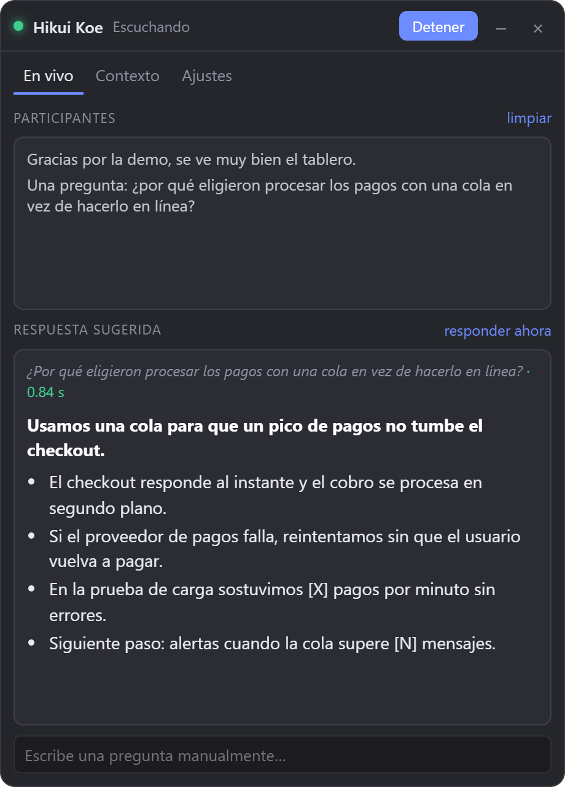
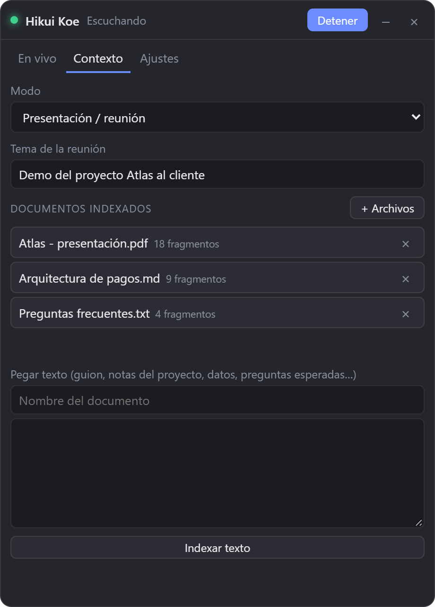

# Hikui Koe

Real-time assistant for presentations and meetings. It listens to the call audio (Meet, Zoom, Teams…),
transcribes what others ask, and suggests what to answer based on **your documents**: the presentation,
project documentation, notes, data.

The name is Japanese: *hikui koe* (低い声) means "low voice", like someone whispering you the answer.

<p align="center">
  
  
</p>

**[Download for Windows](https://github.com/izzyll/hikuikoe/releases/latest/download/HikuiKoe-Setup.exe)** · [All releases](https://github.com/izzyll/hikuikoe/releases)

## What it does

- **Answers from your material, without making things up.** A bold key idea and 3 to 5 bullets you can read at a glance, in first
  person ("we" when talking about the project). If a fact isn't in your documents it leaves a placeholder like `[X %]`
  or suggests confirming it later.
- **Detects questions on its own** and answers instantly; or force an answer with Ctrl+Shift+Space. You can also type the question.
- **Invisible when screen sharing** (`WDA_EXCLUDEFROMCAPTURE`, Windows 10 2004+). It doesn't show up in the taskbar or in Alt+Tab.
- **Private or fast, your choice**:
  - Audio: system loopback (whatever plays through your speakers/headphones). Your microphone is not captured.
  - Transcription: Groq `whisper-large-v3-turbo` (~0.4 s) or local Whisper on the GPU via transformers.js (WebGPU, with WASM/CPU fallback).
  - Answers: local Ollama or very fast APIs with a free tier: [Groq](https://console.groq.com/keys),
    [Cerebras](https://cloud.cerebras.ai) or any OpenAI-compatible API.
  - Documents are indexed locally (`nomic-embed-text` in Ollama); only the transcript and the relevant
    chunks go to the cloud. API keys are stored encrypted with DPAPI.

## Installation

1. Download and install [HikuiKoe-Setup.exe](https://github.com/izzyll/hikuikoe/releases/latest/download/HikuiKoe-Setup.exe) (Windows 10 2004+ / 11).
2. Install [Ollama](https://ollama.com) and open it.
3. `ollama pull nomic-embed-text` (always) and `ollama pull qwen2.5:7b` (only if you'll answer locally).
4. Optional: create a free API key on Groq for near-instant answers and transcription.

## Usage

1. **Context**: enter the meeting topic and add documents (PDF with text, DOCX, HTML, TXT, MD): presentation,
   project documentation, notes, data and questions you expect. The topic also helps transcription with proper names and technical terms. Scanned PDFs have no extractable text.
2. **Settings**: answer and transcription providers. With a dedicated GPU and local Whisper, use `whisper-large-v3-turbo` (~1.5 GB).
3. **Listen** (Ctrl+Shift+L) when the meeting starts.

| Shortcut | Action |
| --- | --- |
| Ctrl+Shift+H | Show / hide |
| Ctrl+Shift+L | Start / stop listening |
| Ctrl+Shift+Space | Answer now |
| Ctrl+Shift+K | Clear transcript |
| Ctrl+Shift+P | (dev only) Toggle visible/hidden in screen captures |

## Development

```bash
npm install
npm run build        # compile TypeScript (src/ → out/)
npm start            # compile and run
npm run dev          # tsc --watch + auto reload; the window DOES appear in screen captures
npm run dev:protect  # dev with the window hidden from captures (like the installed app)
npm run dist         # local installer at dist/HikuiKoe-Setup.exe
```

Data (settings, document index, Whisper models) lives in `%APPDATA%\Hikui Koe`. If data from a version with the
previous name already exists, the app keeps using that folder.

## Publishing a release

Releases are built with GitHub Actions (`.github/workflows/release.yml`) when a tag is pushed:

```bash
git tag v0.2.0
git push origin v0.2.0
```

The workflow takes the version from the tag, builds the installer on Windows and publishes it as a release with `HikuiKoe-Setup.exe`.
Since the file name has no version in it, this link always points to the latest one:
`https://github.com/izzyll/hikuikoe/releases/latest/download/HikuiKoe-Setup.exe`.

The installer is not signed: Windows SmartScreen will show a warning the first time ("More info → Run anyway").

## Architecture

```
src/main.ts            overlay window, audio loopback, global shortcuts, IPC, data migration
src/preload.ts         window.api bridge (typed contract in src/types.d.ts)
src/hf-cache.ts        hfcache:// protocol that downloads Hugging Face models to disk
src/rag.ts             text extraction, chunking, embeddings and cosine search (JSON in userData)
src/llm.ts             assistant prompt and providers (Ollama / OpenAI-compatible APIs)
src/stt.ts             cloud transcription (Groq whisper-large-v3-turbo)
src/ollama.ts          Ollama status, embeddings and chat
src/renderer/          UI, energy-based voice detection, Whisper worker, audio worklet
```

TypeScript is compiled with `tsc -b` to `out/`, with no bundler. There is one project per environment because each has
different globals: `tsconfig.json` (main + preload, Node/CommonJS) and, under `src/renderer/`, the UI one (DOM),
the Whisper worker one (WebWorker) and the audio worklet one. The HTML and CSS stay in `src/renderer/` and load
the compiled JS from `out/renderer/`.
